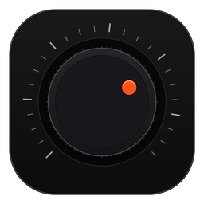
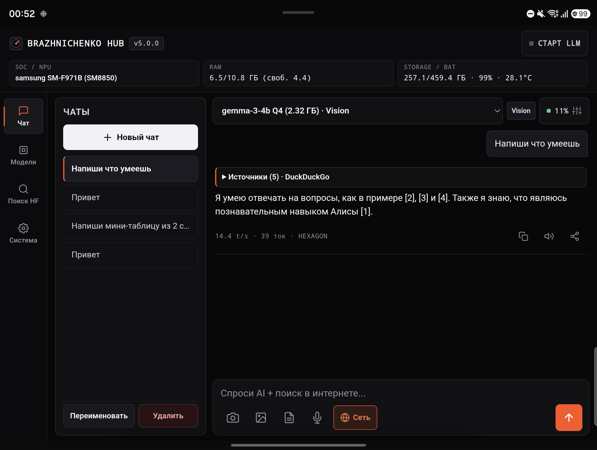
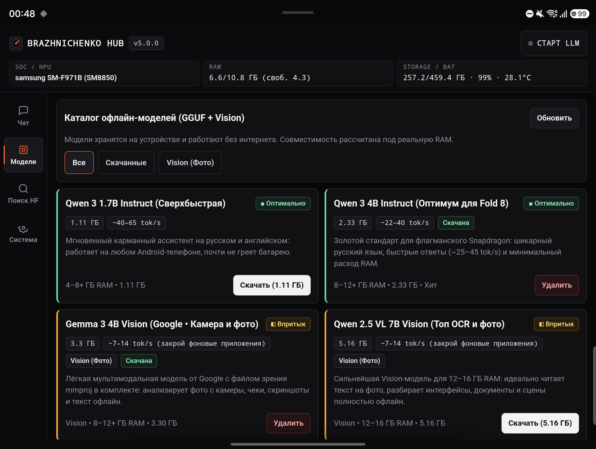

<div align="center">
  
  <h1>Brazhnichenko Hub v5.0</h1>
  <p><strong>Автономный локальный AI-хаб в дизайне Industrial Mono — Android NPU · Windows · macOS · Linux</strong></p>
  <p>
    <a href="https://github.com/Lenodez/brazhnichenko-hub/releases/latest"></a>
    <a href="LICENSE"></a>
    <a href="https://github.com/Lenodez/brazhnichenko-hub/releases/latest"></a>
    <a href="https://github.com/Lenodez/brazhnichenko-hub/releases/latest"></a>
  </p>
</div>

Приватный локальный AI-хаб для запуска открытых **GGUF LLM, Vision-моделей, офлайн-диктовки и генерации медиа** полностью на вашем устройстве — на смартфоне (**Qualcomm Snapdragon Hexagon NPU + Adreno GPU + ARM64 CPU**) и на компьютере (**Windows WPF .NET 11, macOS Apple Silicon Metal, Linux x64/ARM64**). Без облачных подписок, телеметрии и утечки данных.

---

## Что нового в `v5.0.0` (Industrial Mono)

- **Единая дизайн-система Industrial Mono на всех платформах:** строгая аппаратная эстетика в духе измерительных приборов (матовый карбон `#080809` / `#0B0B0D` для OLED и десктопа, чёткая 1px геометрия, табличные моноширинные метрики, инвертированные основные кнопки и сигнальный акцент **Signal Orange `#FF521B`**), единая иконка-лимб для ПК, инсталлятора и Android.
- **Переосмысленная эргономика чата и управления:** левый `Navigation Rail` и компактная шкала телеметрии на ПК и складных экранах, чистая вёрстка ответов без лишних вложенных рамок (максимум ширины для таблиц и кода), спокойные сворачиваемые блоки `<think>` и мгновенное переключение весов `llama-server` при смене модели в выпадающем списке.
- **Системный ассистент по кнопке питания на Android 14–16 / One UI:** добавлена полная связка `HubAssistService` + `HubAssistSessionService` + `HubRecognitionService` и привилегированный запуск `startAssistantActivity` — удержание боковой кнопки питания (Side Key) мгновенно открывает Hub поверх любых экранов с захватом скриншота для Vision и включением микрофона.
- **Надёжное автообновление Android 14–17:** скачивание APK с валидацией архива/пакета и прямой вызов системного `PackageInstaller` из активной `MainActivity` без блокировок фонового старта (`BAL`).

---

## Скачать готовые сборки (`v5.0.0`)

Перейдите в [**Releases → Latest (`v5.0.0`)**](https://github.com/Lenodez/brazhnichenko-hub/releases/latest) и выберите пакет под свою платформу:

| Платформа | Артефакт в Releases | Описание |
|---|---|---|
| **Android (ARM64 NPU/GPU)** | `BrazhnichenkoHub-Android-arm64.apk` | Snapdragon Hexagon NPU + Adreno GPU + CPU, системный ассистент по кнопке питания, офлайн-голос (Sherpa-ONNX), домашний виджет и автообновление Android 14–17 |
| **Windows (x64)** | `LocalAIHub-Setup.exe` | Нативное WPF-приложение (.NET 11) + инсталлятор в стиле **Industrial Mono**: локальный чат, Read-Only ассистент экрана, ComfyUI / SwarmUI, оптимизация VRAM/RAM, MCP-сервер |
| **macOS (Apple Silicon M1–M4)** | `BrazhnichenkoHub-macOS-arm64.tar.gz` | Готовый `Brazhnichenko Hub.app` бандл (self-contained, ускорение Apple Metal) в дизайне **Industrial Mono** |
| **Linux (x64)** | `BrazhnichenkoHub-linux-x64.tar.gz` | Self-contained сборка в дизайне **Industrial Mono** со скриптами `run.sh` и `install-desktop.sh` |
| **Linux (ARM64)** | `BrazhnichenkoHub-linux-arm64.tar.gz` | Self-contained сборка для ARM64 рабочих станций, одноплатников и серверов |

> **Автообновление:** на **Android** и **Windows** новые релизы проверяются и устанавливаются в 1 клик прямо из раздела «Система» / верхней панели через `GitHub Releases`.

---

## Скриншоты `v5.0.0` (Samsung Galaxy Z Fold · Snapdragon `SM8850`)

<p align="center">
  
  
</p>
<p align="center">
  
  
</p>

---

## Ключевые возможности Android (`android/`)

- **Ускорение Qualcomm Hexagon NPU (HTP v73–v85) + Adreno OpenCL GPU + ARM64 CPU** — встроенный `llama.cpp` запускается в изолированном процессе `:llama` через нативный JNI-мост (`libhub_jni.so`), без root и без Termux. На флагманском Snapdragon (`SM8850`): `Qwen 3 4B` ~`22–40 tok/s`, `Gemma 3 4B Vision` ~`14–20 tok/s`, `Qwen 3 8B` ~`11+ tok/s`.
- **0% фонового расхода батареи** — нейросеть не держится в памяти впустую, загружается только по запросу и автоматически выгружается из RAM/NPU по настраиваемому таймеру простоя или кнопкой **«Освободить RAM»**.
- **Полноценный системный цифровой ассистент (вместо Google Assistant / Gemini)** — сервисы `HubAssistService`, `HubAssistSessionService` и `HubRecognitionService`:
  - Мгновенный вызов удержанием кнопки питания, жестом с угла экрана или кнопкой гарнитуры (включая экран блокировки).
  - Назначение отдельной быстрой модели специально для ассистента без смены модели основного чата.
  - Автоматический захват скриншота текущего экрана для **Vision**-анализа + офлайн-диктовка (**Sherpa-ONNX**: `GigaAM v2 Russian` / `Whisper Tiny`) и озвучка ответа (TTS).
- **Гибридный веб-поиск по запросу** — тумблер **`Сеть`** в поле ввода работает из коробки бесплатно и без API-ключей (`DuckDuckGo + Google News + Wikipedia`), а при желании подключает ключи **Tavily** или **Brave Search**. При выключенном тумблере — **100% офлайн**.
- **Управление контекстом и памятью** — точный подсчёт токенов (окно до `32 768`), сжатие длинных диалогов локальной моделью (**«Сжать контекст»**), индивидуальный системный промпт и роль на каждый чат, экспорт в `.md`.
- **Мультимодальность и документы** — Камера Vision, галерея, разбор PDF (извлечение текста или рендер первой страницы для скан-PDF в Vision), `TXT`, `MD`, `CSV`, `JSON`.
- **Интеграция в систему Android** — матовый виджет рабочего стола с быстрым запуском голоса/камеры/PDF, плитка быстрых настроек («Local AI»), ярлыки иконки (App Shortcuts), меню «Поделиться» и действие над выделенным текстом («Спросить в Hub AI»).
- **Адаптивная вёрстка для смартфонов и Fold-устройств** — на узком внешнем экране (`< 600dp`): нижняя панель вкладок, выезжающий список чатов и `Bottom Sheet` с жестами свайпа; на раскрытом Fold / планшете (`≥ 600dp` / `≥ 840dp`): левая приборная рельса навигации, верхняя полоса телеметрии и двухпанельный режим чатов.

---

## Возможности Desktop: Windows (`desktop/`), macOS и Linux (`crossplatform/`)

- **Windows Studio на .NET 11 WPF (`desktop/`):**
  - Приборная компоновка **Industrial Mono**: компактный `Navigation Rail` слева, живая телеметрия GPU / VRAM / RAM / диска в заголовке и явный индикатор активного сервера.
  - **Безопасный системный ассистент экрана (Read-Only):** вызывается поверх любых окон по глобальному хоткею (`Alt+Space`, `Ctrl+Shift+Space`, `Alt+Q`) или кликом по иконке в трее; автоматически передаёт скриншот экрана в Vision-модель, поддерживает локальный голосовой ввод (**Whisper STT**), веб-поиск и озвучку ответа, не имея доступа к модификации файлов или выполнению команд.
  - Единое управление `llama-server` (CUDA / Vulkan / CPU), генерацией фото и видео через **ComfyUI** и **SwarmUI** с автоматическим освобождением VRAM от конфликтующих процессов, советник совместимости моделей по памяти видеокарты, поиск по Hugging Face и встроенный **MCP-сервер**.
- **macOS Apple Silicon & Linux (`crossplatform/`, .NET 11):**
  - Единый веб-интерфейс в стиле **Industrial Mono** поверх локального сервера .NET 11 с автозагрузкой бинарников `llama.cpp` под **Apple Metal (M1–M4)** и **Linux (x64 / ARM64)**, мультисессиями чата, Vision, документами и каталогом GGUF.

---

## Структура репозитория

```text
brazhnichenko-hub/
├── android/          # Android ARM64 приложение (чистый Android SDK без Gradle: Java + JNI C++ + Web UI)
├── desktop/          # Windows WPF приложение (.NET 11), нативный Setup-инсталлятор и скрипты сборки
├── crossplatform/    # Кроссплатформенный локальный хост (.NET 11) для macOS (arm64) и Linux (x64 / arm64)
└── docs/screenshots/ # Актуальные скриншоты и графические материалы v5.0
```

---

## Сборка из исходников

### 1. Android APK (`BrazhnichenkoHub-Android-arm64.apk`)
Сборка работает напрямую на инструментах Android SDK (`aapt2`, `javac`, `d8`, `zipalign`, `apksigner`) без Gradle и тяжёлых зависимостей:

1. Установите **JDK 11+** и **Android SDK** (`platforms;android-35` и `build-tools;35.0.0`).
2. Задайте переменную окружения `ANDROID_HOME` (либо передайте путь через `-AndroidSdk`).
3. Опционально укажите переменные подписи `HUB_KEYSTORE_PATH`, `HUB_KEYSTORE_ALIAS`, `HUB_KEYSTORE_PASS` (при отсутствии скрипт создаст локальный ключ автоматически).
4. Выполните:
   ```powershell
   pwsh -ExecutionPolicy Bypass -File .\desktop\Build-Android.ps1 -Version "5.0.0"
   ```
   Готовый подписанный APK будет сохранён в `desktop\dist\BrazhnichenkoHub-Android-arm64.apk`.

### 2. Windows Setup (`LocalAIHub-Setup.exe`) и macOS / Linux архивы
Требуется **.NET 11 SDK**:

```powershell
# Сборка Windows-приложения и инсталлятора LocalAIHub-Setup.exe
pwsh -ExecutionPolicy Bypass -File .\desktop\Build-Installer.ps1

# Сборка self-contained пакетов для macOS (arm64) и Linux (x64 / arm64)
pwsh -ExecutionPolicy Bypass -File .\desktop\Build-CrossPlatform.ps1 -Version "5.0.0"
```

---

## Лицензия

Проект распространяется под лицензией [MIT](LICENSE).
