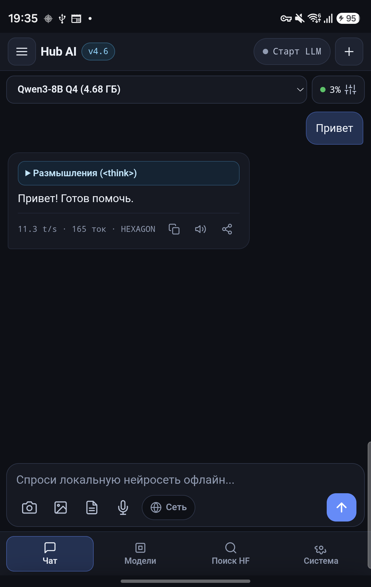
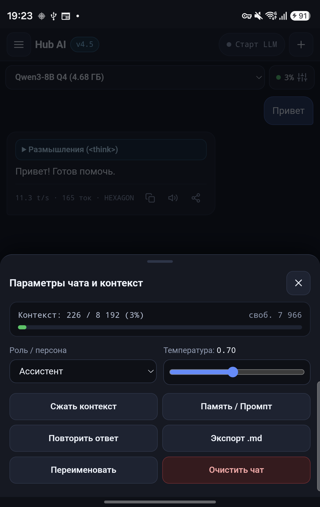
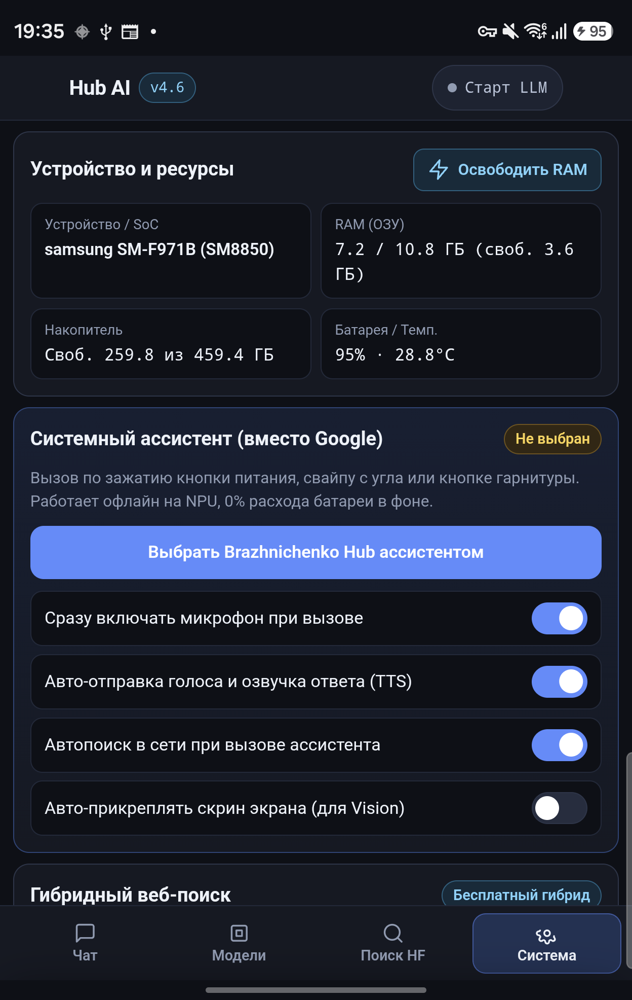

# Brazhnichenko Hub — Local Offline AI (Android NPU + Windows Desktop)

Приватный локальный AI-хаб для запуска открытых **GGUF LLM и Vision-моделей** полностью офлайн на смартфоне (**Qualcomm Snapdragon Hexagon NPU + Adreno GPU + ARM64 CPU**) и на ПК (**Windows WPF + CUDA/Vulkan**). Без облачных подписок, телеметрии и утечки данных.

[](https://github.com/Lenodez/brazhnichenko-hub/releases/latest)
[](LICENSE)
[](https://github.com/Lenodez/brazhnichenko-hub/releases/latest)

---

## Скачать готовые сборки (Все платформы)

Перейди в [**Releases → Latest (`v4.7.0`)**](https://github.com/Lenodez/brazhnichenko-hub/releases/latest) и выбери файл под свою систему:

| Платформа | Файл в Releases | Описание |
|---|---|---|
| **Android (ARM64 NPU/GPU)** | `BrazhnichenkoHub-Android-arm64.apk` (~61 МБ) | Snapdragon Hexagon NPU + Adreno GPU + CPU, системный ассистент, автообновление |
| **Windows (x64)** | `LocalAIHub-Setup.exe` (~1.6 МБ) | Универсальный GUI-установщик WPF приложения (LLM, ComfyUI, фото/видео, голос) |
| **macOS (Apple Silicon M1–M4)** | `BrazhnichenkoHub-macOS-arm64.tar.gz` (~74 МБ) | Готовый `Brazhnichenko Hub.app` бандл (self-contained) |
| **Linux (x64)** | `BrazhnichenkoHub-linux-x64.tar.gz` (~80 МБ) | Self-contained сборка + `run.sh` и `install-desktop.sh` |
| **Linux (ARM64)** | `BrazhnichenkoHub-linux-arm64.tar.gz` (~75 МБ) | Self-contained сборка для ARM64 устройств и серверов |

> **Android:** после установки `v4.7.0` дальнейшие обновления приходят и устанавливаются **прямо внутри приложения** («Система» → «Обновления (GitHub Releases)»).

---

## Скриншоты (Samsung Galaxy Z Fold 8 — сложенный экран)

<p align="center">
  
  
  
</p>

---

## Ключевые возможности Android (`android/`)

- **Нативное ускорение Qualcomm Hexagon NPU (HTP v73–v85) + Adreno OpenCL GPU + ARM64 CPU** — встроенный `llama.cpp` запускается в изолированном процессе `:llama` через собственный JNI-мост (`libhub_jni.so`), без root и без Termux. Проверено на Snapdragon `SM8850` (Galaxy Z Fold 8): `Qwen3-8B Q4_K_M` ~`11+ tok/s`, `Qwen3-4B` ~`25–40 tok/s`.
- **Никакого автопрогрева и фонового расхода батареи** — модель не загружается в RAM/NPU до явного запроса пользователя и автоматически выгружается по таймеру простоя.
- **Системный цифровой ассистент (замена Google Assistant / Gemini)** — полноценный `VoiceInteractionService`: вызов по зажатию кнопки питания, свайпу с угла или кнопке гарнитуры → голосовой ввод → ответ на NPU → офлайн-озвучка TTS + захват скриншота экрана для Vision-моделей.
- **Гибридный веб-поиск (опционально)** — переключатель **`Сеть`** в капсуле ввода + автопоиск для системного ассистента. Из коробки работает бесплатно без ключей (`DuckDuckGo Lite + Google News RSS + Wikipedia`), опционально поддерживает API-ключи **Tavily** и **Brave Search**. При выключенном переключателе — **100% офлайн**.
- **Контроль и сжатие контекста** — точный счётчик токенов из токенизатора `llama-server`, окно до `32 768`, кнопка **«Сжать контекст»** (суммаризация истории локальной LLM в компактную память), кастомный системный промпт на каждый чат, экспорт в Markdown, повтор генерации.
- **Мультимодальность и документы** — Камера Vision, фото из галереи, чтение PDF (извлечение текста + рендер скан-страницы для Vision), TXT/MD/CSV/JSON.
- **Системные поверхности Android** — виджет рабочего стола, плитка быстрых настроек («Local AI»), App Shortcuts, Android Share Sheet и меню выделенного текста («Спросить в Hub AI»).
- **Material 3 Adaptive UX** — на сложенном экране (`Compact < 600dp`): Bottom Nav + Slide-over Drawer чатов + Bottom Sheet с жестами свайпа; на разложенном складном экране / планшете (`Medium / Expanded ≥ 600dp`): вертикальный `Navigation Rail` слева и 2-панельный `List-Detail`, поддержка Android 14–17 Predictive Back и кнопка **«Освободить RAM»**.
- **Встроенное автообновление** — проверяет `GitHub Releases`, скачивает свежий подписанный APK с прогресс-баром и запускает системный установщик Android.

---

## Возможности Windows Desktop (`desktop/`)

- Нативное приложение на **.NET 8 WPF** для локальной работы с LLM (`llama.cpp`), генерации изображений/видео (`ComfyUI`), голосового ввода/TTS, каталога моделей и поиска по Hugging Face.

---

## Структура репозитория

```text
brazhnichenko-hub/
├── android/          # Android ARM64 приложение (чистый Android SDK без Gradle/AndroidX: Java + JNI C++ + Web UI)
├── desktop/          # Windows WPF приложение (.NET 8) + скрипты сборки (Build-Android.ps1, Build-Installer.ps1)
├── crossplatform/    # Кроссплатформенный веб-хост для macOS (Apple Silicon) и Linux (x64 / ARM64)
└── docs/screenshots/ # Скриншоты интерфейса
```

---

## Сборка Android APK из исходников

Сборка выполняется на чистом Android SDK (`aapt2`, `javac`, `d8`, `zipalign`, `apksigner`) без Gradle и AndroidX:

1. Установи **JDK 11+** и **Android SDK** (`platforms;android-35` и `build-tools;35.0.0`).
2. Задай переменную окружения `ANDROID_HOME` (или передай `-AndroidSdk`).
3. Для подписи своим ключом опционально укажи `HUB_KEYSTORE_PATH`, `HUB_KEYSTORE_ALIAS`, `HUB_KEYSTORE_PASS` (иначе скрипт создаст локальный self-signed ключ автоматически).
4. Запусти:
   ```powershell
   pwsh -ExecutionPolicy Bypass -File .\desktop\Build-Android.ps1 -Version "4.7.0"
   ```
   Готовый APK появится в `desktop\dist\BrazhnichenkoHub-Android-arm64.apk`.

---

## Лицензия

Распространяется под лицензией [MIT](LICENSE).
